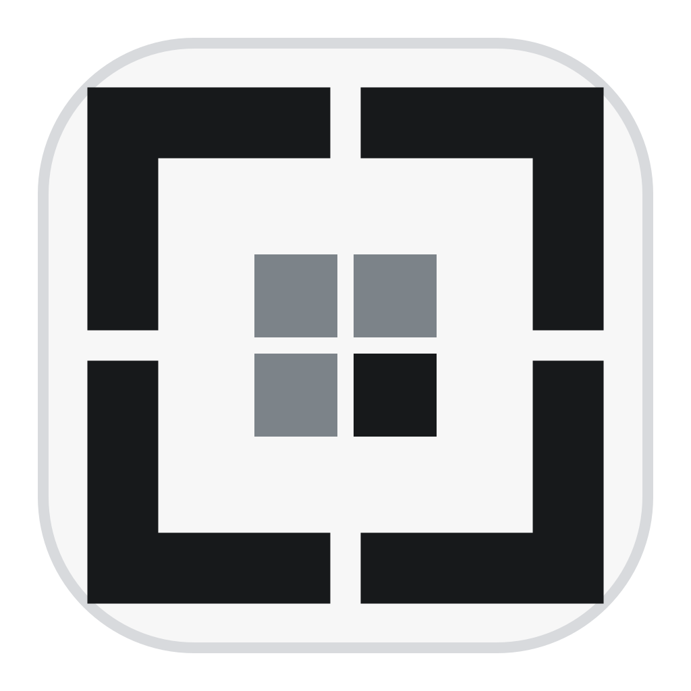

<p align="center">
  
</p>

<h1 align="center">GDBox</h1>

<p align="center">
  <b>An open-source AI workbench for Godot developers — for the work beyond the code</b>
</p>

<p align="center">
  <a href="LICENSE"></a>
  
  
  
</p>

<p align="center">
  <a href="https://github.com/ueboxai/gdbox/releases">Download</a> ·
  <a href="CHANGELOG.md">Changelog</a> ·
  <a href="README.md">中文</a>
</p>

---

GDBox comes from the same company as [Unreal Box](https://github.com/ueboxai/uebox) and shares its interface and workflow, built for Godot 4.

## Features

- **Generated straight into the project**: sprite animations, tilesets, sound effects, loopable music, voice lines, images and 3D models, written as ready-to-use Godot resources (SpriteFrames, TileSet, WAV with loop points, glb)
- **Verify every change**: `godot_check` imports and runs the project headless and reports script and engine errors; `godot_run` presses inputs on a schedule and watches values; `godot_screenshot` shows the AI a frame
- **Editor link**: with the GDBox Link addon, the AI sees the nodes you selected and the scene you have open, can run the game in your editor and open scenes; scenes it edits on disk reload in your editor
- **One art style**: a per-project style pack (look, pixel scale, palette, reference images) applied to every generation
- **Experience and skills**: error lessons learned per project; built-in Godot skills, and your own
- **Goal mode** `/goal` and **team mode** `/team`
- **80+ model providers**: Claude, GPT, DeepSeek, Ollama, LM Studio and more — bring your own key
- **Asset management**: project library, asset library, 3D viewer, notebooks — no Godot needed
- **MCP / CLI** for Codex, Claude Code, Cursor and scripts

## Quick start

1. Download from [Releases](https://github.com/ueboxai/gdbox/releases) (Windows)
2. **Settings → Models → Add provider**, enter your API key; pick it under **Default models → Chat** (it must support tool calling)
3. **Settings → Projects**: check that Godot 4 was found (otherwise click Choose… and pick the Godot executable)
4. **Projects → Import**, choose a folder with `project.godot`, double-click to open it (installs the GDBox Link addon)
5. **Sidebar → AI chat**, try "generate an 8-frame run cycle for the hero and hook it up to Player"

## Privacy

- No account, no first-party server; keys are encrypted on your machine and requests go straight to the providers you configure
- Only checks for updates by default; self-builds without an update source make no requests
- With a local model, AI requests never leave your machine

## Platforms

Windows first; macOS / Linux build from source. Godot 4.x.
Editor addon source: [`resources/godot/addons/gdbox_link`](resources/godot/addons/gdbox_link).

## Development

```bash
pnpm install
pnpm dev
pnpm verify:changed   # before committing — only what you changed (~30 s)
pnpm verify           # before push / PR — the full gate
```

- Working with an AI coding agent: read [AGENTS.md](AGENTS.md) first
- Contributing: [CONTRIBUTING.md](CONTRIBUTING.md) · [Testing](docs/contributing/testing.md)
- Packaging and releases: [packaging.md](docs/contributing/packaging.md)
- More: [`docs/`](docs/) · [UI design standards](docs/UI-Design-Standards.md) · [SECURITY](SECURITY.md) · [Third-party notices](THIRD-PARTY-NOTICES.md)

## License

[Apache-2.0](LICENSE)

Godot is a trademark of the Godot Foundation. This project is not affiliated with the Godot Foundation.
