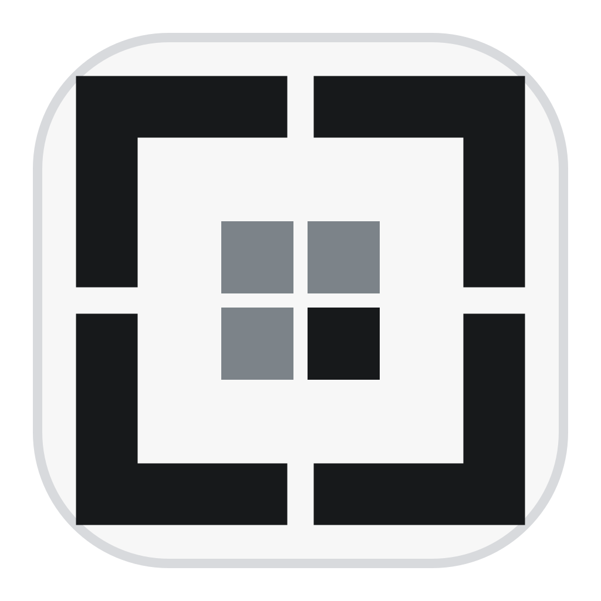

<p align="center">
  
</p>

<h1 align="center">GDBox</h1>

<p align="center">
  <b>给 Godot 开发者的开源 AI 工作台：写代码之外的那些活</b>
</p>

<p align="center">
  <a href="LICENSE"></a>
  
  
  
</p>

<p align="center">
  <a href="https://github.com/ueboxai/gdbox/releases">下载</a> ·
  <a href="CHANGELOG.md">更新日志</a> ·
  <a href="README.en.md">English</a>
</p>

---

GDBox 和[虚幻盒子](https://github.com/ueboxai/uebox)出自同一家公司，界面和交互一致，面向 Godot 4。

## 功能

- **生成即资产**：精灵帧动画、瓦片集、音效、可循环的背景音乐、配音、图片、3D 模型，直接写成工程里能用的 Godot 资源（SpriteFrames、TileSet、带循环点的 WAV、glb）
- **改完就验**：`godot_check` 无头导入并运行、报出脚本和引擎错误；`godot_run` 按时间表按键、盯数值变化；`godot_screenshot` 截一帧给 AI 看
- **编辑器联动**：装上 GDBox Link 插件后，AI 看得到你选中的节点和打开的场景，能在编辑器里运行游戏、打开场景；改了你开着的场景会自动重新加载
- **美术风格统一**：工程级风格包（画风、像素尺寸、调色板、参考图），所有生成自动套用
- **经验与技能**：按工程积累报错经验；内置 Godot 技能，也可以自己写
- **目标模式** `/goal` 与 **团队模式** `/team`
- **80+ 模型服务商**：Claude、GPT、DeepSeek、Ollama、LM Studio 等，自带密钥
- **素材管理**：项目库、资产库、3D 查看器、知识库，不开 Godot 也能用
- **MCP / CLI**：给 Codex、Claude Code、Cursor 和脚本用

## 快速开始

1. 从 [Releases](https://github.com/ueboxai/gdbox/releases) 下载安装（Windows）
2. **设置 → 模型 → 添加服务商**，填 API 密钥；**默认模型 → 对话** 选它（模型需支持工具调用）
3. **设置 → 项目** 确认找到了 Godot 4（没找到就点「指定…」选 Godot 可执行文件）
4. **项目库 → 导入项目**，选含 `project.godot` 的文件夹，双击打开（自动装上 GDBox Link 插件）
5. **侧边栏 → AI 对话**，试试「给主角生成一套 8 帧跑步动画，接到 Player 上」

## 隐私

- 无账号，无官方服务器；密钥加密存本机，请求直连你配的服务商
- 默认只检查更新；未配置更新源的自行构建不发任何请求
- 用本机模型时 AI 请求不出本机

## 平台

Windows 为主力平台；macOS / Linux 可从源码构建。Godot 4.x。
编辑器插件源码：[`resources/godot/addons/gdbox_link`](resources/godot/addons/gdbox_link)。

## 开发

```bash
pnpm install
pnpm dev
pnpm verify:changed   # 提交前，只查改动（约 30 秒）
pnpm verify           # push / PR 前，完整门禁
```

- 用 AI 编码助手开发：先读 [AGENTS.md](AGENTS.md)
- 贡献：[CONTRIBUTING.zh-CN.md](CONTRIBUTING.zh-CN.md) · [测试](docs/contributing/testing.md)
- 打包与发版：[packaging.zh-CN.md](docs/contributing/packaging.zh-CN.md)
- 其他文档：[`docs/`](docs/) · [UI 设计标准](docs/UI-Design-Standards.md) · [SECURITY](SECURITY.md) · [第三方声明](THIRD-PARTY-NOTICES.md)

## 许可

[Apache-2.0](LICENSE)

Godot 是 Godot Foundation 的商标，本项目与 Godot Foundation 无隶属关系。
